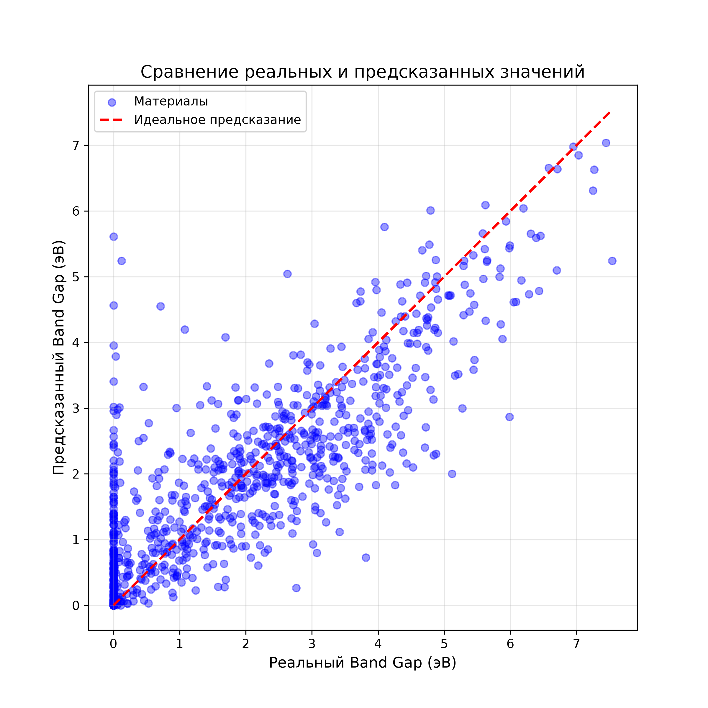

# 🔋 Lithium Band Gap ML Predictor

Это интерактивное веб-приложение на базе машинного обучения, которое предсказывает ширину запрещенной зоны (**Band Gap**) для материалов, содержащих литий. Проект создан для ускорения поиска новых материалов для литий-ионных аккумуляторов.

## 🚀 Живая демонстрация (Live Demo)
Вы можете протестировать приложение прямо в браузере, не устанавливая ничего на компьютер:
👉 **[Открыть веб-приложение](https://lithium-bandgap-ml-aju6jnzwuggsi5jqhf2otg.streamlit.app/)**

## 🛠 Технологии
* **Данные:** Materials Project API
* **Обработка данных:** Pandas, Pymatgen
* **Машинное обучение:** XGBoost, Scikit-learn, Matminer
* **Веб-интерфейс:** Streamlit

## 📊 Как это работает
1. Скрипт скачивает данные о стабильных материалах с литием из базы Materials Project.
2. Химические формулы разбираются на признаки с помощью библиотеки `pymatgen`.
3. Модель `XGBoost` обучается предсказывать `band_gap` на основе состава и кристаллической структуры.
4. Точность модели (R²) составляет **0.790**, средняя абсолютная ошибка (MAE) — **0.540 эВ**.

## 💻 Запуск локально
Если вы хотите запустить проект на своем компьютере:
1. Клонируйте репозиторий:
   `git clone https://github.com/VADZIM041/lithium-bandgap-ml.git`
2. Установите зависимости:
   `pip install -r requirements.txt`
3. Запустите приложение:
   `streamlit run app.py`
## 📈 Визуализация результатов
Ниже приведен график сравнения реальных и предсказанных значений Band Gap:

## 🧪 Валидация модели
Для проверки обобщающей способности модели был использован `GroupShuffleSplit` по химическим формулам (чтобы исключить утечку данных). Модель показала R² = 0.790 на совершенно новых составах, что доказывает её надежность.
